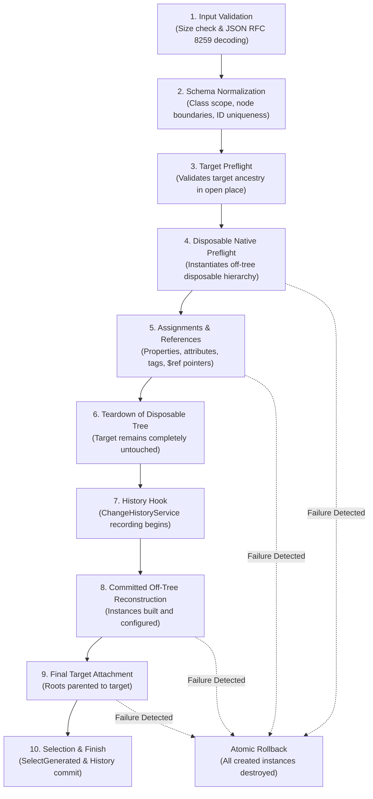

# Json2GUI Schema Guide

This document is the normative authoring reference for Json2GUI schema version `2`, plugin version `2.2.0`.

- **Verification Date:** September 24, 2026
- **Verified Studio Build:** Roblox Studio `0.740.0.7400927`
- **Specification Status:** Stable / Normative
- **Engine Identity:** `Script:Json2GUI`

The schema is deliberately strict. Unknown fields, unsupported classes, unsupported properties, unresolved references, unsafe asset strings, invalid parent relationships, and out-of-range values fail before generated roots are attached to the target.

---

## 1. Document Principles

1. **Strict JSON Format:** Input must be standard JSON (RFC 8259). Luau table syntax, JSON5, JavaScript objects, trailing commas, single-quoted strings, unquoted keys, and NaN/Infinity numeric literals are strictly rejected.
2. **Explicit Double Quotes:** All object keys and string values must be enclosed in ASCII double quotes (`"`).
3. **Comment Fields:** Comments must use schema-defined `Comment` or `$comment` string fields. Inline comments (`//` or `/* */`) are rejected by the parser.
4. **Zero Null Tolerance:** JSON `null` is rejected everywhere in the document outside string literals. Optional fields must be omitted entirely instead of assigned `null`.
5. **Dense Arrays:** All arrays (`Roots`, `Children`, `Tags`, numeric vectors, keypoint lists) must be dense with consecutive integer indices starting at 1. Sparse arrays or object-like arrays are rejected.
6. **Case Sensitivity:** Class names, property names, and field names require exact PascalCase Roblox capitalization matching reflection metadata. Case-insensitive fallback is provided exclusively for enum item names and `$type` descriptors.
7. **Finite Numbers:** Every numeric value must be finite. `NaN`, `Infinity`, and `-Infinity` cause immediate parse or validation failures.
8. **Dynamic UI Scope & Whitelist:** A class is accepted if it inherits from an approved UI base class (`GuiBase2d`, `LayerCollector`, `UIBase`, `UIComponent`, `UIConstraint`, `UILayout`), is an approved structural class (14 classes), or is an approved `ViewportFrame` scene class (37 classes). Executable scripts, network remotes, and services are strictly blocked.
9. **Off-Tree Preflight & Atomicity:** Before any instance is attached to the target, the complete hierarchy is instantiated off-tree, configured, cross-referenced, and validated in temporary memory. If any error occurs, all staged instances are destroyed immediately, leaving the target parent completely untouched.
10. **Native Studio Authority:** Roblox Studio engine reflection and native Luau property assignment remain the final authority after schema and policy checks succeed.

---

## 2. Accepted Root Forms

Json2GUI accepts exactly three document root forms.

### 2.1 Single Node Root

A solitary node object at the root of the JSON document:

```json
{
  "ClassName": "ScreenGui",
  "Name": "MainGui",
  "Properties": {
    "ResetOnSpawn": false,
    "ZIndexBehavior": "Sibling"
  },
  "Children": [
    {
      "ClassName": "Frame",
      "Name": "Container",
      "Properties": {
        "Size": [1, 0, 1, 0],
        "BackgroundTransparency": 1
      }
    }
  ]
}
```

The engine normalizes this internally as `Roots = [ <Node> ]`.

### 2.2 Dense Root Array

A dense JSON array containing one or more top-level node objects:

```json
[
  {
    "ClassName": "ScreenGui",
    "Name": "HUD",
    "Properties": {
      "ResetOnSpawn": false
    }
  },
  {
    "ClassName": "Folder",
    "Name": "UIMetadata",
    "Children": [
      {
        "ClassName": "Configuration",
        "Name": "Settings"
      }
    ]
  }
]
```

The array must contain at least one node and cannot contain `null` items or sparse keys.

### 2.3 Document Wrapper With Options

A root object providing document-level configuration options and metadata alongside the `Roots` array:

```json
{
  "Roots": [
    {
      "ClassName": "ScreenGui",
      "Id": "mainHud",
      "Name": "GameHUD",
      "Properties": {
        "ResetOnSpawn": false,
        "ZIndexBehavior": "Sibling"
      },
      "Children": [
        {
          "ClassName": "Frame",
          "Id": "statusCard",
          "Name": "StatusCard",
          "Properties": {
            "Size": [0, 240, 0, 80],
            "Position": [0, 20, 0, 20],
            "BackgroundColor3": "#1E222B"
          }
        }
      ]
    }
  ],
  "Options": {
    "SelectGenerated": false
  },
  "Comment": "Production HUD layout wrapper",
  "$comment": "Alternate documentation field"
}
```

#### Document Wrapper Fields

| Field | Required | Type | Limit | Description |
|---|:---:|---|---|---|
| `Roots` | **Yes** | dense array | $1 \le N \le 5,000$ | Non-empty array of root node objects. |
| `Options` | No | object | $\le 16$ fields | Document-level configuration options object. |
| `Comment` | No | string | $\le 10,000$ bytes | Optional documentation string (ignored by engine). |
| `$comment` | No | string | $\le 10,000$ bytes | Optional documentation string (ignored by engine). |

Unknown wrapper fields fail validation.

---

## 3. Document Options

When using the Document Wrapper, the `Options` dictionary accepts the following settings:

| Option | Type | Default | Permitted Values | Description |
|---|---|---|---|---|
| `SelectGenerated` | boolean | `true` | `true`, `false` | When `true`, automatically selects all attached root instances in Studio Explorer after successful generation. Set to `false` during iterative development to prevent newly generated roots from becoming the next active target parent. |
| `GenerationLabel` | string | `"Json2GUI: Generate GUI"` | string ($\le 1,000$ bytes) | Human-readable label recorded in Roblox Studio undo history (`ChangeHistoryService`). |
| `ValidationWarningThreshold` | integer | `200` | integer ($10 \le n \le 500$) | Maximum allowed schema validation warnings before processing aborts. |

Unknown fields inside `Options` fail validation.

---

## 4. Node Object Contract

Every node object in `Roots` or `Children` follows this exact JSON structure:

```json
{
  "ClassName": "Frame",
  "Id": "mainCard",
  "Name": "ProfileCard",
  "Properties": {
    "Size": [0, 320, 0, 180],
    "Position": [0.5, -160, 0.5, -90],
    "BackgroundColor3": "#242830",
    "BorderSizePixel": 0
  },
  "Attributes": {
    "CardType": "Profile",
    "Elevation": 2,
    "AccentColor": {
      "$type": "Color3",
      "Hex": "#2F7CF6"
    }
  },
  "Tags": [
    "Json2GUI",
    "CardComponent",
    "Interactive"
  ],
  "Children": [],
  "Comment": "Main profile card surface",
  "$comment": "Alternate comment key"
}
```

### Complete Node Fields Reference

| Field | Required | Type | Limits | Description |
|---|:---:|---|---|---|
| `ClassName` | **Yes** | string | 1–1,000 bytes | Exact name of the constructible Roblox class (e.g. `"Frame"`, `"TextLabel"`, `"ScreenGui"`). |
| `Id` | No | string | 1–1,000 bytes | Unique document-wide reference identifier (`^[A-Za-z_][A-Za-z0-9_.-]*$`). Cannot be `"@target"`. |
| `Name` | No | string | 0–10,000 bytes | Assigned to `Instance.Name`. No control characters. Mutually exclusive with `Properties.Name`. |
| `Properties` | No | object | $\le 25,000$ properties | Property assignments for this exact class. Controlled engine properties are rejected. |
| `Attributes` | No | object | $\le 10,000$ attributes | Custom instance attributes applied via `Instance:SetAttribute`. |
| `Tags` | No | dense string array | $\le 1,000$ tags | CollectionService tags applied in order via `CollectionService:AddTag`. |
| `Children` | No | dense node array | $\le 1,000,000$ children | Child instance nodes parented under this instance. Max hierarchy depth is 1,000. |
| `Comment` | No | string | $\le 10,000,000$ bytes | Optional documentation string (ignored by engine). |
| `$comment` | No | string | $\le 10,000,000$ bytes | Optional documentation string (ignored by engine). |

Unknown node fields fail validation.

---

## 5. String, Identifier, And Name Constraints

### 5.1 Class Names (`ClassName`)
- **Length:** 1 to 100 bytes.
- **Pattern:** `^[A-Za-z_][A-Za-z0-9_]*$`
- **Casing:** Exact PascalCase matching Roblox Studio reflection metadata.
- **Compatibility Alias:** `UIFlexLayout` automatically maps to `UIListLayout` (with diagnostic warning).

### 5.2 Node Reference Identifiers (`Id`)
- **Length:** 1 to 128 bytes.
- **Pattern:** `^[A-Za-z_][A-Za-z0-9_.-]*$`
- **Uniqueness:** Must be globally unique across all roots and descendants in the document.
- **Reserved Identifier:** `"@target"` is reserved for pointing to the selected Studio target instance and cannot be declared as a node `Id`.

#### Valid IDs:
```text
viewportCamera
main_panel
button.confirm-1
_header
```

#### Invalid IDs:
```text
1panel           (starts with digit)
main card        (contains whitespace)
@target          (reserved identifier)
ui/frame         (invalid character /)
```

### 5.3 Instance Names (`Name`)
- **Length:** 0 to 1,000 bytes.
- **Character Set:** UTF-8 strings. Control characters (`[\x00-\x1F\x7F]`) are rejected.
- **Normalization:** If `Properties.Name` is provided, it is automatically normalized into the instance `Name`. Defining both top-level `Name` and `Properties.Name` on the same node is rejected.

### 5.4 Attribute Names
- **Length:** 1 to 100 bytes.
- **Pattern:** `^[A-Za-z0-9_]+$`
- **Reserved Prefix:** Names starting with `RBX` or `rbx` (case-insensitive) are reserved by Roblox engine internals and rejected.
- Control characters are rejected.

### 5.5 CollectionService Tags
- **Length:** 1 to 100 bytes per tag.
- **Uniqueness:** Tags must be non-empty strings.
- Control characters are rejected.

---

## 6. Cross-Node References & Pointer Architecture

References establish instance pointer properties (such as `CurrentCamera`, `Adornee`, `Part0`, `Part1`, `PrimaryPart`, `Value`) between generated nodes or to the active target parent.

### 6.1 Compact Reference
```json
{
  "$ref": "viewportCamera"
}
```

### 6.2 Tagged Reference Object
```json
{
  "$type": "Reference",
  "Id": "viewportCamera"
}
```
*Note: `"Value"` is accepted as an alias for `"Id"` in tagged reference objects (`{"$type": "Reference", "Value": "viewportCamera"}`).*

### 6.3 Reserved Target Pointer (`@target`)
The special reference `"@target"` resolves to the active parent instance selected in Studio. It is permitted exclusively on:
- `ObjectValue.Value`
- `Highlight.Adornee`
- `SelectionBox.Adornee`
- `SelectionSphere.Adornee`

```json
{
  "ClassName": "ObjectValue",
  "Name": "TargetParentRef",
  "Properties": {
    "Value": {
      "$ref": "@target"
    }
  }
}
```

`@target` cannot be declared as a node `Id`.

### 6.4 Comprehensive Reference Properties Table

| Class | Reference Property | Required / Optional | Target Class Requirement |
|---|---|:---:|---|
| `ViewportFrame` | `CurrentCamera` | Optional | `Camera` |
| `ObjectValue` | `Value` | Optional | Any `Instance` or `"@target"` |
| `Highlight` | `Adornee` | Optional | Any `Instance` or `"@target"` |
| `Model` | `PrimaryPart` | Optional | A generated descendant `BasePart` within that exact Model |
| `Sound` | `SoundGroup` | Optional | `SoundGroup` |
| `WeldConstraint` | `Part0`, `Part1` | **Mandatory** | `BasePart` |
| `Weld` | `Part0`, `Part1` | **Mandatory** | `BasePart` |
| `Motor6D` | `Part0`, `Part1` | **Mandatory** | `BasePart` |
| `Beam` | `Attachment0`, `Attachment1` | **Mandatory** | `Attachment` |
| `Trail` | `Attachment0`, `Attachment1` | **Mandatory** | `Attachment` |

---

## 7. Attributes

Attributes are applied via `Instance:SetAttribute(name, value)`.

### Rules:
- Maximum 256 attributes per node.
- Names are 1–100 alphanumeric/underscore bytes (`[A-Za-z0-9_]+`).
- Cannot start with `RBX` or `rbx`.
- Primitive JSON strings, numbers, and booleans are stored directly.
- Tables, vectors, colors, and structured values require an explicit `$type` tag.
- Roblox attributes cannot store `Instance` references (`$ref` or `$type: "Reference"` is rejected).
- Comments (`$comment` or `Comment`) inside `Attributes` are ignored by generation and permitted for schema documentation.

### Attribute Example:
```json
{
  "ClassName": "Frame",
  "Attributes": {
    "WidgetVersion": 2,
    "ThemeName": "StudioDark",
    "IsOpen": true,
    "InitialSize": {
      "$type": "Vector2",
      "X": 420,
      "Y": 280
    },
    "Accent": {
      "$type": "Color3",
      "Hex": "#2F7CF6"
    },
    "$comment": "Configuration metadata for responsive layout"
  }
}
```

---

## 8. CollectionService Tags

Tags are applied in sequence via `CollectionService:AddTag(instance, tag)`.

### Rules:
- Maximum 64 tags per node.
- `Tags` must be a dense array of non-empty strings.
- Maximum 100 bytes per tag string.
- Control characters are rejected.

### Tags Example:
```json
{
  "ClassName": "TextButton",
  "Tags": [
    "Json2GUI",
    "PrimaryAction",
    "InteractiveButton",
    "RequiresThemeUpdate"
  ]
}
```

---

## 9. Exhaustive Datatype Specifications (20 Types)

For property assignments, Json2GUI resolves values in this exact sequence:
1. Resolve `$ref` or `$type: "Reference"`.
2. Decode explicit `$type` objects.
3. Read the destination property's current native datatype on the temporary instance.
4. Decode compact shorthand forms according to the expected datatype.
5. Apply safe primitive type coercions when appropriate (e.g. numeric strings -> number).
6. Apply the converted value via protected native assignment.

Tagged `$type` names are case-insensitive. Field names are case-sensitive.

---

### 9.1 UDim
Represents a 1D coordinate component with relative scale and pixel offset.

- **Compact 2-Number Array `[scale, offset]`:**
  ```json
  [0, 12]
  ```
- **Compact Single Number Offset (Automatic Shorthand):**
  ```json
  16
  ```
  *(Equivalent to `[0, 16]` / `UDim.new(0, 16)`).*
- **Tagged Object:**
  ```json
  {
    "$type": "UDim",
    "Scale": 0.5,
    "Offset": -10
  }
  ```
- **Allowed Tagged Fields:** `Value`, `Components`, `Scale`, `Offset`.

---

### 9.2 UDim2
Represents a 2D coordinate for UI positioning and sizing.

- **Compact 4-Number Array `[xScale, xOffset, yScale, yOffset]`:**
  ```json
  [1, -24, 0, 48]
  ```
- **Compact 2-Number Offset Array `[xOffset, yOffset]`:**
  ```json
  [420, 260]
  ```
  *(Equivalent to `[0, 420, 0, 260]` / `UDim2.fromOffset(420, 260)`).*
- **Compact Paired UDim Array `[[xScale, xOffset], [yScale, yOffset]]`:**
  ```json
  [[1, -24], [0, 48]]
  ```
- **Named Dictionary Form (`Width` / `Height` or `X` / `Y`):**
  ```json
  {
    "Width": [1, -24],
    "Height": [0, 48]
  }
  ```
- **Tagged Object:**
  ```json
  {
    "$type": "UDim2",
    "Components": [0.5, -100, 0.5, -50]
  }
  ```
- **Allowed Tagged Fields:** `Value`, `Components`, `X`, `Y`, `Width`, `Height`.

---

### 9.3 Vector2
Represents a 2D vector in screen coordinates, anchor points, or texture dimensions.

- **Compact 2-Number Array `[x, y]`:**
  ```json
  [0.5, 0.5]
  ```
- **Tagged Object:**
  ```json
  {
    "$type": "Vector2",
    "X": 100,
    "Y": 200
  }
  ```
- **Allowed Tagged Fields:** `Value`, `Components`, `X`, `Y`.

---

### 9.4 Vector3
Represents a 3D point, size, or direction in studs.

- **Compact 3-Number Array `[x, y, z]`:**
  ```json
  [2, 3, 4]
  ```
- **Tagged Object:**
  ```json
  {
    "$type": "Vector3",
    "X": 10,
    "Y": 5,
    "Z": -20
  }
  ```
- **Allowed Tagged Fields:** `Value`, `Components`, `X`, `Y`, `Z`.

---

### 9.5 Vector2int16
Represents a 2D integer vector with signed 16-bit integers (`-32,768` to `32,767`).

- **Compact Array / Tagged Object:**
  ```json
  {
    "$type": "Vector2int16",
    "Value": [1920, 1080]
  }
  ```
- **Allowed Tagged Fields:** `Value`, `Components`, `X`, `Y`. Non-integer or out-of-range values fail.

---

### 9.6 Vector3int16
Represents a 3D integer vector with signed 16-bit integers (`-32,768` to `32,767`).

- **Compact Array / Tagged Object:**
  ```json
  {
    "$type": "Vector3int16",
    "Value": [10, -5, 20]
  }
  ```
- **Allowed Tagged Fields:** `Value`, `Components`, `X`, `Y`, `Z`. Non-integer or out-of-range values fail.

---

### 9.7 Color3
Represents RGB color.

- **Hexadecimal String (`"#RGB"` or `"#RRGGBB"`):**
  ```json
  "#2F7CF6"
  ```
- **Hexadecimal String With Alpha (`"#RGBA"` or `"#RRGGBBAA"`):**
  ```json
  "#2F7CF6FF"
  ```
  *(Alpha component is automatically parsed and discarded; Color3 represents pure RGB).*
- **CSS Color Strings (`rgb(...)` / `rgba(...)`):**
  ```json
  "rgb(47, 124, 246)"
  ```
  ```json
  "rgba(47, 124, 246, 0.8)"
  ```
- **Packed 24-bit Integer (`0` to `16,777,215`):**
  ```json
  3112182
  ```
- **Compact 0–255 RGB Array:**
  ```json
  [47, 124, 246]
  ```
- **Tagged 0–255 RGB Object:**
  ```json
  {
    "$type": "Color3",
    "RGB": [47, 124, 246]
  }
  ```
- **Tagged 0.0–1.0 Unit Float Object:**
  ```json
  {
    "$type": "Color3",
    "Unit": [0.184, 0.486, 0.965]
  }
  ```
- **Tagged 0.0–1.0 HSV Object:**
  ```json
  {
    "$type": "Color3",
    "HSV": [0.597, 0.81, 0.965]
  }
  ```
- **Allowed Tagged Fields:** `Hex`, `HSV`, `Unit`, `RGB`, `Value`, `Components`, `R`, `G`, `B`.

---

### 9.8 ColorSequence
Represents a gradient color progression over time ($[0.0, 1.0]$).

- **Constant Color (converted to uniform sequence):**
  ```json
  "#2F7CF6"
  ```
- **2-Color Start/End Shortcut:**
  ```json
  ["#2F7CF6", "#1046A0"]
  ```
- **Keypoint Objects List:**
  ```json
  {
    "$type": "ColorSequence",
    "Keypoints": [
      { "Time": 0.0, "Value": "#2A303C" },
      { "Time": 0.5, "Value": "#1E222A" },
      { "Time": 1.0, "Value": "#14171C" }
    ]
  }
  ```
  *(Both `"Value"` and `"Color"` are accepted as the keypoint color field).*
- **Compact Array Keypoints `[time, color]`:**
  ```json
  [
    [0.0, [42, 48, 60]],
    [1.0, [20, 24, 30]]
  ]
  ```
- **Validation Rules:** Times must start at `0.0`, end at `1.0` (with $10^{-4}$ boundary tolerance), and increase strictly monotonically.

---

### 9.9 NumberSequence
Represents a numeric curve over time ($[0.0, 1.0]$) with optional envelope tolerance.

- **Constant Number:**
  ```json
  0.5
  ```
- **2-Number Start/End Shortcut:**
  ```json
  [0.0, 1.0]
  ```
- **Keypoint Objects List with Envelope:**
  ```json
  {
    "$type": "NumberSequence",
    "Keypoints": [
      { "Time": 0.0, "Value": 0.0, "Envelope": 0.0 },
      { "Time": 0.5, "Value": 0.8, "Envelope": 0.1 },
      { "Time": 1.0, "Value": 1.0, "Envelope": 0.0 }
    ]
  }
  ```
- **Compact Array Keypoints `[time, value, envelope?]`:**
  ```json
  [
    [0.0, 0.0],
    [0.5, 0.8, 0.1],
    [1.0, 1.0]
  ]
  ```
- **Validation Rules:** Times must start at `0.0`, end at `1.0` (with $10^{-4}$ tolerance), and increase strictly. Envelope must be $\ge 0$.

---

### 9.10 Rect
Represents a 2D pixel or slice bounding rectangle.

- **Compact 4-Number Array `[minX, minY, maxX, maxY]`:**
  ```json
  [0, 0, 128, 128]
  ```
- **Structured Min/Max Object:**
  ```json
  {
    "$type": "Rect",
    "Min": [8, 8],
    "Max": [24, 24]
  }
  ```
- **Allowed Tagged Fields:** `Min`, `Max`, `Value`, `Components`.

---

### 9.11 CFrame
Represents a 3D spatial coordinate frame (position and orientation) for cameras and ViewportFrame scene objects.

- **3-Number Position Array `[x, y, z]`:**
  ```json
  [0, 5, 10]
  ```
- **6-Number Position + Euler Degrees `[x, y, z, rx, ry, rz]`:**
  ```json
  [0, 2, 10, 0, 180, 0]
  ```
- **12-Number Transformation Matrix:**
  ```json
  [0, 5, 0, 1, 0, 0, 0, 1, 0, 0, 0, 1]
  ```
- **Tagged Object with Position and Orientation (Degrees):**
  ```json
  {
    "$type": "CFrame",
    "Position": [0, 2, 10],
    "Orientation": [0, 180, 0]
  }
  ```
- **LookAt Target Construction:**
  ```json
  {
    "$type": "CFrame",
    "Position": [0, 10, 20],
    "LookAt": [0, 0, 0]
  }
  ```
- **Allowed Tagged Fields:** `Position`, `Orientation`, `Rotation`, `LookAt`, `Value`, `Components`.
- *Note: Euler angles in `Orientation` and `Rotation` are always specified in **degrees**.*

---

### 9.12 NumberRange
Represents a closed numeric interval $[min, max]$.

- **Single Number (uniform interval):**
  ```json
  2.5
  ```
- **Compact 2-Number Array `[min, max]`:**
  ```json
  [1.0, 5.0]
  ```
- **Tagged Object:**
  ```json
  {
    "$type": "NumberRange",
    "Min": 1.0,
    "Max": 5.0
  }
  ```
- **Allowed Tagged Fields:** `Min`, `Max`, `Value`, `Components`. Minimum cannot exceed maximum.

---

### 9.13 BrickColor
Represents standard palette BrickColors.

- **Name String:**
  ```json
  "Really red"
  ```
- **Palette Integer Number:**
  ```json
  1004
  ```
- **Tagged Object:**
  ```json
  {
    "$type": "BrickColor",
    "Name": "Medium stone grey"
  }
  ```
- **Allowed Tagged Fields:** `Value`, `Name`, `Number`.

---

### 9.14 Font
Represents modern typography and font faces.

- **Legacy Enum.Font Name String:**
  ```json
  "GothamBold"
  ```
- **Modern Font Family Name:**
  ```json
  "BuilderSans"
  ```
- **Font Asset URI String:**
  ```json
  "rbxassetid://12187365364"
  ```
- **Internal Built-in Font JSON:**
  ```json
  "rbxasset://fonts/families/SourceSansPro.json"
  ```
- **Tagged Font Object:**
  ```json
  {
    "$type": "Font",
    "Family": "rbxasset://fonts/families/GothamSSm.json",
    "Weight": "Bold",
    "Style": "Normal"
  }
  ```
- **Automatic Delegation:** When modern font asset strings or tagged font objects are assigned to the legacy `Font` property on text instances (`TextLabel`, `TextButton`, `TextBox`), Json2GUI automatically delegates the value to `FontFace`.

---

### 9.15 Enum
Represents Roblox engine enumerations.

- **Contextual Item Name String:**
  ```json
  "Center"
  ```
- **Case-Insensitive Item Name:**
  ```json
  "center"
  ```
- **Numeric Enum Value:**
  ```json
  0
  ```
  Numeric values are matched against each item's numeric `EnumItem.Value` (e.g. `Enum.FillDirection.Horizontal` is `0` and `Vertical` is `1`); Json2GUI does not treat them as 1-based ordinals.
- **Full Enum Identifier String:**
  ```json
  "Enum.TextXAlignment.Center"
  ```
- **Tagged Enum Object:**
  ```json
  {
    "$type": "Enum",
    "EnumType": "TextXAlignment",
    "Name": "Center"
  }
  ```
- **Allowed Tagged Fields:** `EnumType`, `Name`, `Value`.

---

### 9.16 Ray
Represents a 3D ray with origin point and direction vector.

- **Tagged Ray Object:**
  ```json
  {
    "$type": "Ray",
    "Origin": [0, 5, 0],
    "Direction": [0, -10, 0]
  }
  ```
- **Allowed Tagged Fields:** `Origin`, `Direction`.

---

### 9.17 PhysicalProperties
Represents physical simulation attributes for scene objects inside `ViewportFrame`.

- **Tagged 5-Parameter Object:**
  ```json
  {
    "$type": "PhysicalProperties",
    "Density": 1.0,
    "Friction": 0.5,
    "Elasticity": 0.25,
    "FrictionWeight": 1.0,
    "ElasticityWeight": 1.0
  }
  ```
- **Allowed Tagged Fields:** `Density`, `Friction`, `Elasticity`, `FrictionWeight`, `ElasticityWeight`.

---

### 9.18 Axes
Represents a bitset of coordinate axes (`X`, `Y`, `Z`).

- **Tagged Object:**
  ```json
  {
    "$type": "Axes",
    "Values": ["X", "Z"]
  }
  ```
- **Allowed Tagged Fields:** `Values`, `Value`. At least one valid `Enum.Axis` item is required.

---

### 9.19 Faces
Represents a bitset of normal faces (`Top`, `Bottom`, `Left`, `Right`, `Front`, `Back`).

- **Tagged Object:**
  ```json
  {
    "$type": "Faces",
    "Values": ["Top", "Front"]
  }
  ```
- **Allowed Tagged Fields:** `Values`, `Value`. At least one valid `Enum.NormalId` item is required.

---

### 9.20 Reference
Represents an explicit document instance reference.

- **Tagged Object:**
  ```json
  {
    "$type": "Reference",
    "Id": "previewCamera"
  }
  ```
- Equivalent to `{"$ref": "previewCamera"}`.

---

## 10. Supported Generation Targets

The generation target must be an existing Instance attached to the currently open place DataModel (`target:IsDescendantOf(game)`).

Target resolution rules:
1. **Nothing selected:** Automatically defaults to `StarterGui`.
2. **Exactly one instance selected:** Generates into that exact Instance.
3. **Two or more instances selected:** Operation is blocked with diagnostic message.
4. **DataModel (`game`) selected:** Explicitly rejected with error.

### Supported Target Classes

| Target Class | Allowed Child Roots | Typical Usage |
|---|---|---|
| `StarterGui` | `ScreenGui`, GUI objects, Folders, Configurations, Sounds, ValueBase | Default location for top-level player interfaces. |
| `PlayerGui` | `ScreenGui`, GUI objects, Folders, Configurations, Sounds, ValueBase | Active live player GUI during Studio testing. |
| `ScreenGui` | Frames, GUI objects, layouts, constraints, Folders, Sounds | Direct parent for HUD and menu layouts. |
| `Frame` | Child frames, labels, buttons, layouts, constraints, components | Sub-panel or component container. |
| `ScrollingFrame` | Items, list layouts, grid layouts, cards, buttons | Scrollable list or inventory container. |
| `CanvasGroup` | Child frames, vector graphics, buttons, labels | Group alpha and masked rendering surface. |
| `SurfaceGui` | Frames, labels, buttons, interactive 3D panels | In-world 3D surface interface. |
| `BillboardGui` | Frames, labels, icons, indicators | Over-head player names or world markers. |
| `ViewportFrame` | `Camera`, `WorldModel`, `Model`, whitelist scene objects | 3D GUI item, avatar, or preview viewport. |
| `ReplicatedStorage` | Folders, Configurations, Sounds, ValueBase, UI prefabs | Replicated UI templates and configuration assets. |
| `Workspace` | Folders, Configurations, SurfaceGui, BillboardGui, Sound | Direct world-placed GUI containers. |
| `Folder` / `Configuration` | Any valid GUI root, structural node, or configuration | Organizational hierarchy container. |

---

## 11. Supported Classes

Json2GUI accepts constructible classes across three distinct profiles:

### 11.1 Dynamic UI Classes
Any constructible class that inherits from one of the six approved UI base classes:

```text
GuiBase2d
LayerCollector
UIBase
UIComponent
UIConstraint
UILayout
```

#### Core UI Classes:
- **Layer Collectors:** `ScreenGui`, `BillboardGui`, `SurfaceGui`
- **Containers:** `Frame`, `ScrollingFrame`, `CanvasGroup`, `ViewportFrame`, `VideoFrame`
- **Content Displays:** `TextLabel`, `ImageLabel`
- **Interactive Controls:** `TextButton`, `ImageButton`, `TextBox`
- **Layout Managers:** `UIListLayout`, `UIGridLayout`, `UIPageLayout`, `UITableLayout`
- **Decorators & Modifiers:** `UICorner`, `UIStroke`, `UIGradient`, `UIPadding`, `UIScale`
- **Constraints:** `UIAspectRatioConstraint`, `UISizeConstraint`, `UITextSizeConstraint`

### 11.2 Structural Classes (14 Classes)
Allowed anywhere in the document hierarchy:

```text
Folder
Configuration
Sound
LocalizationTable
StringValue
IntValue
BoolValue
NumberValue
ObjectValue
Color3Value
Vector3Value
CFrameValue
RayValue
BrickColorValue
```

### 11.3 ViewportFrame Scene Whitelist (37 Classes)
Allowed **exclusively** as descendants of a `ViewportFrame`:

```text
1. Scene Containers (2)
   WorldModel, Model

2. Spatial & Camera (3)
   Camera, Attachment, Bone

3. Parts & Geometry (5)
   Part, MeshPart, WedgePart, CornerWedgePart, TrussPart

4. Meshes & Presentation (5)
   SpecialMesh, BlockMesh, CylinderMesh, SurfaceAppearance, Decal, Texture

5. Lighting (3)
   PointLight, SpotLight, SurfaceLight

6. Effects & Highlights (4)
   ParticleEmitter, Beam, Trail, Highlight

7. Rigging & Character Mesh (11)
   Humanoid, HumanoidDescription, AnimationController, Animator,
   BodyColors, Shirt, Pants, ShirtGraphic, CharacterMesh,
   WrapLayer, WrapTarget

8. Joints & Constraints (3)
   WeldConstraint, Weld, Motor6D
```

*Note: Scene objects placed at the document root or beneath ordinary GUI containers fail validation.*

---

## 12. Complete Property Allowlists

`Name` is allowlisted on every supported class. Engine-controlled properties (Section 13) are strictly rejected.

### 12.1 Shared GuiObject Properties
Allowed on all 2D GUI elements (`Frame`, `TextLabel`, `TextButton`, `TextBox`, `ImageLabel`, `ImageButton`, `ScrollingFrame`, `CanvasGroup`, `ViewportFrame`, `VideoFrame`):

```text
Active                    (boolean)
AnchorPoint               (Vector2)
AutomaticSize             (Enum.AutomaticSize)
BackgroundColor3          (Color3)
BackgroundTransparency    (number, [0, 1])
BorderColor3              (Color3)
BorderMode                (Enum.BorderMode)
BorderSizePixel           (number)
ClipsDescendants          (boolean)
Interactable              (boolean)
LayoutOrder               (number)
Position                  (UDim2)
Rotation                  (number, degrees)
Selectable                (boolean)
Size                      (UDim2)
SizeConstraint            (Enum.SizeConstraint)
Visible                   (boolean)
ZIndex                    (number)
```

---

### 12.2 Text Component Properties
Allowed on `TextLabel`, `TextButton`, and `TextBox`:

```text
ContentText               (string, read-only)
Font                      (Enum.Font, font family, or font asset URI)
FontFace                  (Font)
LineHeight                (number)
MaxVisibleGraphemes       (number)
RichText                  (boolean)
Text                      (string)
TextColor3                (Color3)
TextDirection             (Enum.TextDirection)
TextScaled                (boolean)
TextSize                  (number)
TextStrokeColor3          (Color3)
TextStrokeTransparency    (number, [0, 1])
TextTransparency          (number, [0, 1])
TextTruncate              (Enum.TextTruncate)
TextWrapped               (boolean)
TextXAlignment            (Enum.TextXAlignment)
TextYAlignment            (Enum.TextYAlignment)
```

#### Class-Specific Text Properties:
- `TextBox`: `ClearTextOnFocus`, `CursorPosition`, `MultiLine`, `PlaceholderColor3`, `PlaceholderText`, `SelectionStart`, `ShowNativeInput`, `TextEditable`

---

### 12.3 Image Component Properties
Allowed on `ImageLabel` and `ImageButton`:

```text
Image                     (Asset URI)
ImageColor3               (Color3)
ImageRectOffset           (Vector2)
ImageRectSize             (Vector2)
ImageTransparency         (number, [0, 1])
IsLoaded                  (boolean, read-only)
ResampleMode              (Enum.ResamplerMode)
ScaleType                 (Enum.ScaleType)
SliceCenter               (Rect)
SliceScale                (number)
TileSize                  (UDim2)
```

---

### 12.4 Button Component Properties
Allowed on `TextButton` and `ImageButton`:

```text
AutoButtonColor           (boolean)
Modal                     (boolean)
Selected                  (boolean)
Style                     (Enum.ButtonStyle)
```

---

### 12.5 LayerCollector Properties
Allowed on `ScreenGui`, `BillboardGui`, and `SurfaceGui`:

```text
Enabled                   (boolean)
ResetOnSpawn              (boolean)
ZIndexBehavior            (Enum.ZIndexBehavior)
```

#### Class-Specific LayerCollector Properties:
- `ScreenGui`: `ClipToDeviceSafeArea`, `DisplayOrder`, `SafeAreaCompatibility`, `ScreenInsets`
- `SurfaceGui`: `Adornee` (`$ref` or `"@target"`), `AlwaysOnTop`, `CanvasSize`, `Face`, `LightInfluence`, `MaxDistance`, `PixelsPerStud`, `SizingMode`, `ToolPunchThroughDistance`, `ZOffset`
- `BillboardGui`: `Active`, `Adornee` (`$ref` or `"@target"`), `AlwaysOnTop`, `Brightness`, `ClipsDescendants`, `DistanceLowerLimit`, `DistanceStep`, `DistanceUpperLimit`, `ExtentsOffset`, `ExtentsOffsetWorld`, `LightInfluence`, `MaxDistance`, `PlayerToHideFrom`, `SizeOffset`, `StudsOffset`, `StudsOffsetWorld`

---

### 12.6 Scrolling & Group Container Properties
- `ScrollingFrame`: `AutomaticCanvasSize`, `BottomImage`, `CanvasPosition` (Vector2), `CanvasSize` (UDim2), `ElasticBehavior`, `HorizontalScrollBarInset`, `MidImage`, `ScrollBarImageColor3`, `ScrollBarImageTransparency`, `ScrollBarThickness`, `ScrollingDirection`, `ScrollingEnabled`, `TopImage`, `VerticalScrollBarInset`, `VerticalScrollBarPosition`
- `CanvasGroup`: `GroupColor3`, `GroupTransparency`
- `ViewportFrame`: `Ambient`, `CurrentCamera` (`$ref`), `ImageColor3`, `ImageTransparency`, `LightColor`, `LightDirection` (Vector3)
- `VideoFrame`: `Looped`, `Playing`, `TimePosition`, `Video` (Asset URI), `Volume`

---

### 12.7 UI Layouts, Constraints & Decorators
- `UIListLayout`: `FillDirection`, `HorizontalAlignment`, `HorizontalFlex`, `ItemLineAlignment`, `Padding` (UDim), `SortOrder`, `VerticalAlignment`, `VerticalFlex`, `Wraps`
- `UIGridLayout`: `CellPadding` (UDim2), `CellSize` (UDim2), `FillDirection`, `FillDirectionMaxCells`, `HorizontalAlignment`, `SortOrder`, `StartCorner`, `VerticalAlignment`
- `UIPageLayout`: `Animated`, `Circular`, `EasingDirection`, `EasingStyle`, `FillDirection`, `GamepadInputEnabled`, `Padding` (UDim), `ScrollWheelInputEnabled`, `SortOrder`, `TouchInputEnabled`, `TweenTime`
- `UITableLayout`: `FillDirection`, `HorizontalAlignment`, `SortOrder`, `VerticalAlignment`, `Padding` (UDim2)
- `UICorner`: `CornerRadius` (UDim or single number offset)
- `UIStroke`: `ApplyStrokeMode`, `Color`, `LineJoinMode`, `Thickness`, `Transparency`
- `UIGradient`: `Color` (ColorSequence), `Offset` (Vector2), `Rotation` (number, degrees), `Transparency` (NumberSequence)
- `UIPadding`: `PaddingBottom` (UDim), `PaddingLeft` (UDim), `PaddingRight` (UDim), `PaddingTop` (UDim)
- `UIScale`: `Scale` (number)
- `UIAspectRatioConstraint`: `AspectRatio` (number), `AspectType` (Enum.AspectType), `DominantAxis` (Enum.DominantAxis)
- `UISizeConstraint`: `MaxSize` (Vector2), `MinSize` (Vector2)
- `UITextSizeConstraint`: `MaxTextSize` (number), `MinTextSize` (number)

---

### 12.8 Structural & Value Object Properties
- `Sound`: `Looped`, `PlaybackSpeed`, `Playing`, `RollOffMaxDistance`, `RollOffMinDistance`, `RollOffMode`, `SoundGroup` (`$ref`), `SoundId` (Asset URI), `TimePosition`, `Volume`
- `LocalizationTable`: `Contents`
- `StringValue`: `Value` (string)
- `IntValue`: `Value` (integer)
- `BoolValue`: `Value` (boolean)
- `NumberValue`: `Value` (number)
- `Color3Value`: `Value` (Color3)
- `Vector3Value`: `Value` (Vector3)
- `CFrameValue`: `Value` (CFrame)
- `BrickColorValue`: `Value` (BrickColor)
- `RayValue`: `Value` (Ray)
- `ObjectValue`: `Value` (`$ref` or `"@target"`)

---

### 12.9 ViewportFrame Scene Object Properties
- `Camera`: `CFrame` (CFrame), `CameraType`, `FieldOfView`, `FieldOfViewMode`, `Focus`, `HeadLocked`, `HeadScale`
- `WorldModel`: `UseWorkspaceCollisionGroups`
- `Model`: `LevelOfDetail`, `ModelStreamingMode`, `PrimaryPart` (`$ref`), `WorldPivot`
- `Part`, `WedgePart`, `CornerWedgePart`, `TrussPart`: `Anchored`, `BrickColor`, `CFrame`, `CanCollide`, `CastShadow`, `Color`, `Material`, `MaterialVariant`, `Position`, `Orientation`, `Rotation`, `Reflectance`, `Size` (Vector3, > 0), `Transparency`
- `MeshPart`: `Anchored`, `BrickColor`, `CFrame`, `CanCollide`, `CastShadow`, `Color`, `CollisionFidelity`, `DoubleSided`, `Material`, `RenderFidelity`, `Size`, `TextureID`, `Transparency`
- `SpecialMesh`: `MeshType`, `MeshId` (Asset URI), `TextureId` (Asset URI), `Offset`, `Scale`, `VertexColor`
- `BlockMesh`, `CylinderMesh`: `Offset`, `Scale`, `VertexColor`
- `SurfaceAppearance`: `AlphaMode`, `ColorMap`, `EmissiveMask`, `EmissiveStrength`, `MetalnessMap`, `NormalMap`, `RoughnessMap`
- `Attachment`: `Axis`, `CFrame`, `Orientation`, `Position`, `SecondaryAxis`, `Visible`
- `Bone`: `Axis`, `CFrame`, `Orientation`, `Position`, `SecondaryAxis`, `Transform`, `Visible`
- `PointLight`, `SpotLight`, `SurfaceLight`: `Angle`, `Brightness`, `Color`, `Enabled`, `Face`, `Range`, `Shadows`
- `ParticleEmitter`: `Acceleration`, `Brightness`, `Color` (ColorSequence), `Drag`, `EmissionDirection`, `Enabled`, `Lifetime` (NumberRange), `Rate`, `RotSpeed`, `Rotation`, `Size` (NumberSequence), `Speed` (NumberRange), `Texture` (Asset URI), `TimeScale`, `Transparency` (NumberSequence)
- `Beam`: `Attachment0` (`$ref`), `Attachment1` (`$ref`), `Brightness`, `Color` (ColorSequence), `CurveSize0`, `CurveSize1`, `Enabled`, `FaceCamera`, `LightEmission`, `Segments`, `Texture` (Asset URI), `Transparency` (NumberSequence), `Width0`, `Width1`
- `Trail`: `Attachment0` (`$ref`), `Attachment1` (`$ref`), `Color` (ColorSequence), `Enabled`, `FaceCamera`, `Lifetime`, `MaxLength`, `MinLength`, `Texture` (Asset URI), `Transparency` (NumberSequence), `WidthScale` (NumberSequence)
- `Highlight`: `Adornee` (`$ref` or `"@target"`), `DepthMode`, `Enabled`, `FillColor`, `FillTransparency`, `OutlineColor`, `OutlineTransparency`
- `WeldConstraint`, `Weld`: `Part0` (`$ref`), `Part1` (`$ref`), `C0` (CFrame), `C1` (CFrame), `Enabled`
- `Motor6D`: `Part0` (`$ref`), `Part1` (`$ref`), `C0` (CFrame), `C1` (CFrame), `Transform` (CFrame), `CurrentAngle`, `DesiredAngle`, `MaxVelocity`, `Enabled`
- `CharacterMesh`: `BaseTextureId`, `BodyPart`, `MeshId`, `OverlayTextureId`
- `Humanoid`: `DisplayDistanceType`, `HealthDisplayType`, `NameDisplayDistance`, `RigType`
- `HumanoidDescription`: `ClimbAnimation`, `FallAnimation`, `Head`, `IdleAnimation`, `JumpAnimation`, `MoodAnimation`, `RunAnimation`, `SwimAnimation`, `WalkAnimation`
- `BodyColors`: `HeadColor3`, `LeftArmColor3`, `LeftLegColor3`, `RightArmColor3`, `RightLegColor3`, `TorsoColor3`
- `Shirt`, `Pants`: `Color3`, `ShirtTemplate` / `PantsTemplate` (Asset URI)
- `ShirtGraphic`: `Graphic` (Asset URI)

---

## 13. Controlled Properties

The following properties are managed exclusively by the engine and cannot be assigned inside `Properties`:

```text
Parent                  (Managed by hierarchy nesting and generation target)
ClassName               (Managed by node ClassName field)
Source                  (Blocked: executable script source)
LinkedSource            (Blocked: executable script source)
RunContext              (Blocked: script execution context)
ScriptGuid              (Blocked: internal engine identifier)
SourceAssetId           (Blocked: internal asset pointer)
RobloxLocked            (Blocked: internal engine protection)
Archivable              (Blocked: internal replication state)
Sandboxed               (Blocked: internal execution mode)
Capabilities            (Blocked: security capabilities)
DefinesCapabilities     (Blocked: security capabilities)
UniqueId                (Blocked: internal identity GUID)
HistoryId               (Blocked: internal history tracker)
Attributes              (Managed by node Attributes object)
AttributesReplicate     (Blocked: internal serialization)
AttributesSerialize     (Blocked: internal serialization)
Tags                    (Managed by node Tags array)
```

### Mutually Exclusive Rules
1. Do not define both top-level `Name` and `Properties.Name` on the same node.
2. Do not combine `CFrame` with `Position`, `Orientation`, or `Rotation` on the same 3D scene node.
3. Do not combine `Color` with `BrickColor` on the same BasePart.

---

## 14. Asset Policy

Properties requiring approved Roblox asset references:
- `ImageLabel.Image`, `ImageButton.Image`
- `VideoFrame.Video`
- `Sound.SoundId`
- `SpecialMesh.MeshId`, `SpecialMesh.TextureId`
- `MeshPart.TextureID` *(Note: `MeshPart.MeshId` is engine read-only and rejected)*
- `ParticleEmitter.Texture`, `Beam.Texture`, `Trail.Texture`
- `Decal.Texture`, `Texture.Texture`
- `SurfaceAppearance.ColorMap`, `NormalMap`, `MetalnessMap`, `RoughnessMap`, `EmissiveMask`
- `Shirt.ShirtTemplate`, `Pants.PantsTemplate`, `ShirtGraphic.Graphic`
- `CharacterMesh.MeshId`, `BaseTextureId`, `OverlayTextureId`

### Approved URI Schemes:
1. **Roblox Asset ID:**
   ```text
   rbxassetid://123456789
   ```
2. **Numeric ID String Shorthand:**
   ```text
   "123456789"
   ```
3. **Internal Built-in Textures:**
   ```text
   rbxasset://textures/StudioSharedUI/scripts.png
   rbxasset://textures/ui/GuiImagePlaceholder.png
   ```
4. **Internal Built-in Font Families:**
   ```text
   rbxasset://fonts/families/SourceSansPro.json
   rbxasset://fonts/families/GothamSSm.json
   ```
5. **Internal Built-in Audio:**
   ```text
   rbxasset://sounds/electronic_beep.wav
   ```

### URI Constraints:
- Maximum length: 512 bytes.
- No whitespace or control characters (`[\x00-\x20]`).
- Directory traversal (`..`) is strictly rejected.
- HTTP, HTTPS, local disk paths (`file://`, `C:\`), and UNC shares are rejected.

---

## 15. Architectural Limits

All string and JSON limits are measured in bytes.

| Parameter | Limit | Failure Diagnostic |
|---|---:|---|
| Maximum JSON input length | 100,000,000 bytes | `Schema exceeds the 100000000-byte input limit.` |
| Maximum persisted editor text | 20,000,000 bytes | Session-only warning; editor does not persist across restart. |
| Maximum total nodes | 1,000,000 nodes | `Schema exceeds the maximum of 1000000 instances.` |
| Maximum hierarchy depth | 1,000 levels | `... exceeds the maximum hierarchy depth of 1000.` |
| Direct children per node | 1,000,000 children | `...Children exceeds the limit of 1000000.` |
| Properties per node | 25,000 properties | `...Properties exceeds the limit of 25000 entries.` |
| Attributes per node | 10,000 attributes | `...Attributes exceeds the limit of 10000 entries.` |
| Tags per node | 1,000 tags | `...Tags exceeds the limit of 1000.` |
| Maximum ID string length | 1,000 bytes | `...Id has an invalid length.` |
| Maximum Name string length | 10,000 bytes | `...Name exceeds 10000 bytes.` |
| Maximum Key, Class, Attribute, or Tag length | 1,000 bytes | `... has an invalid length.` |
| Maximum Comment string length | 10,000,000 bytes | `... exceeds 10000000 bytes.` |
| Maximum GenerationLabel length | 1,000 bytes | `Options.GenerationLabel exceeds 1000 bytes.` |
| Maximum Asset URI string length | 1,024 bytes | `... has an invalid asset URI length.` |
| Maximum retained warnings | 500 warnings | Warnings list capped at 500 entries (or `ValidationWarningThreshold`). |

---

## 16. Complete Production-Grade Examples

### 16.1 Production HUD with Responsive TopBar and Action Controls

```json
{
  "Roots": [
    {
      "ClassName": "ScreenGui",
      "Id": "mainHud",
      "Name": "PlayerHUD",
      "Properties": {
        "ResetOnSpawn": false,
        "ZIndexBehavior": "Sibling",
        "ScreenInsets": "DeviceSafeInsets"
      },
      "Attributes": {
        "Version": 2,
        "Author": "DesignSystem"
      },
      "Tags": ["Json2GUI", "HUD"],
      "Children": [
        {
          "ClassName": "Frame",
          "Id": "topBar",
          "Name": "TopBar",
          "Properties": {
            "Size": [1, 0, 0, 56],
            "BackgroundColor3": "#1A1D24",
            "BorderSizePixel": 0
          },
          "Children": [
            {
              "ClassName": "UIPadding",
              "Properties": {
                "PaddingLeft": 16,
                "PaddingRight": 16
              }
            },
            {
              "ClassName": "TextLabel",
              "Name": "Title",
              "Properties": {
                "Size": [0, 200, 1, 0],
                "BackgroundTransparency": 1,
                "Font": "GothamBold",
                "Text": "Json2GUI Dashboard",
                "TextColor3": "#F0F2F5",
                "TextSize": 18,
                "TextXAlignment": "Left"
              }
            },
            {
              "ClassName": "TextButton",
              "Name": "ActionButton",
              "Properties": {
                "AnchorPoint": [1, 0.5],
                "Position": [1, 0, 0.5, 0],
                "Size": [0, 110, 0, 36],
                "BackgroundColor3": "#2F7CF6",
                "BorderSizePixel": 0,
                "AutoButtonColor": true,
                "Font": "GothamMedium",
                "Text": "Upgrade",
                "TextColor3": "#FFFFFF",
                "TextSize": 14
              },
              "Children": [
                {
                  "ClassName": "UICorner",
                  "Properties": {
                    "CornerRadius": 6
                  }
                }
              ]
            }
          ]
        }
      ]
    }
  ],
  "Options": {
    "SelectGenerated": false
  }
}
```

---

### 16.2 Modern Modal Dialog with Scrolling Content & UIStroke

```json
{
  "ClassName": "Frame",
  "Name": "SettingsModal",
  "Properties": {
    "AnchorPoint": [0.5, 0.5],
    "Position": [0.5, 0, 0.5, 0],
    "Size": [0, 480, 0, 360],
    "BackgroundColor3": "#1E222A",
    "BorderSizePixel": 0
  },
  "Children": [
    {
      "ClassName": "UICorner",
      "Properties": {
        "CornerRadius": 8
      }
    },
    {
      "ClassName": "UIStroke",
      "Properties": {
        "Color": "#3E4452",
        "Thickness": 1,
        "Transparency": 0.2
      }
    },
    {
      "ClassName": "TextLabel",
      "Name": "ModalHeader",
      "Properties": {
        "Size": [1, 0, 0, 48],
        "Position": [0, 0, 0, 0],
        "BackgroundTransparency": 1,
        "Font": "BuilderSans",
        "Text": "Audio Preferences",
        "TextColor3": "#FFFFFF",
        "TextSize": 18,
        "TextXAlignment": "Left"
      },
      "Children": [
        {
          "ClassName": "UIPadding",
          "Properties": {
            "PaddingLeft": 20
          }
        }
      ]
    },
    {
      "ClassName": "ScrollingFrame",
      "Name": "ContentList",
      "Properties": {
        "Position": [0, 20, 0, 56],
        "Size": [1, -40, 1, -76],
        "BackgroundTransparency": 1,
        "BorderSizePixel": 0,
        "ScrollBarThickness": 6,
        "ScrollBarImageColor3": "#5A6475",
        "AutomaticCanvasSize": "Y",
        "CanvasSize": [0, 0, 0, 0]
      },
      "Children": [
        {
          "ClassName": "UIListLayout",
          "Properties": {
            "FillDirection": "Vertical",
            "SortOrder": "LayoutOrder",
            "Padding": 10
          }
        },
        {
          "ClassName": "Frame",
          "Name": "SettingRow",
          "Properties": {
            "Size": [1, 0, 0, 44],
            "BackgroundColor3": "#282C36",
            "BorderSizePixel": 0
          },
          "Children": [
            {
              "ClassName": "UICorner",
              "Properties": {
                "CornerRadius": 6
              }
            },
            {
              "ClassName": "TextLabel",
              "Name": "SettingLabel",
              "Properties": {
                "Size": [0.7, 0, 1, 0],
                "Position": [0, 14, 0, 0],
                "BackgroundTransparency": 1,
                "Font": "SourceSans",
                "Text": "Spatial Sound Reverb",
                "TextColor3": "#E0E4EC",
                "TextSize": 15,
                "TextXAlignment": "Left"
              }
            }
          ]
        }
      ]
    }
  ]
}
```

---

### 16.3 Responsive Inventory Grid with Aspect Ratio Constraints

```json
{
  "ClassName": "ScrollingFrame",
  "Name": "InventoryGrid",
  "Properties": {
    "Size": [1, 0, 1, 0],
    "BackgroundTransparency": 1,
    "BorderSizePixel": 0,
    "ScrollBarThickness": 6,
    "AutomaticCanvasSize": "Y",
    "CanvasSize": [0, 0, 0, 0]
  },
  "Children": [
    {
      "ClassName": "UIPadding",
      "Properties": {
        "PaddingTop": 16,
        "PaddingBottom": 16,
        "PaddingLeft": 16,
        "PaddingRight": 16
      }
    },
    {
      "ClassName": "UIGridLayout",
      "Properties": {
        "CellSize": [0, 96, 0, 96],
        "CellPadding": [0, 12, 0, 12],
        "SortOrder": "LayoutOrder",
        "HorizontalAlignment": "Center"
      }
    },
    {
      "ClassName": "Frame",
      "Name": "Slot_01",
      "Properties": {
        "BackgroundColor3": "#252932",
        "BorderSizePixel": 0
      },
      "Children": [
        {
          "ClassName": "UICorner",
          "Properties": {
            "CornerRadius": 8
          }
        },
        {
          "ClassName": "UIStroke",
          "Properties": {
            "Color": "#454D5D",
            "Thickness": 1
          }
        },
        {
          "ClassName": "UIAspectRatioConstraint",
          "Properties": {
            "AspectRatio": 1.0
          }
        },
        {
          "ClassName": "ImageLabel",
          "Name": "Icon",
          "Properties": {
            "AnchorPoint": [0.5, 0.5],
            "Position": [0.5, 0, 0.5, 0],
            "Size": [0.75, 0, 0.75, 0],
            "BackgroundTransparency": 1,
            "Image": "rbxasset://textures/ui/GuiImagePlaceholder.png"
          }
        }
      ]
    }
  ]
}
```

---

### 16.4 3D ViewportFrame Item Preview with Rigged Motor6D and Lighting

```json
{
  "ClassName": "ViewportFrame",
  "Id": "viewportSurface",
  "Name": "ItemShowcase",
  "Properties": {
    "Size": [0, 360, 0, 270],
    "BackgroundColor3": "#12151B",
    "BorderSizePixel": 0,
    "CurrentCamera": {
      "$ref": "sceneCamera"
    },
    "LightColor": "#FFFFFF",
    "LightDirection": [-1, -2, -1]
  },
  "Children": [
    {
      "ClassName": "UICorner",
      "Properties": {
        "CornerRadius": 8
      }
    },
    {
      "ClassName": "Camera",
      "Id": "sceneCamera",
      "Properties": {
        "CFrame": {
          "$type": "CFrame",
          "Position": [0, 4, 12],
          "LookAt": [0, 2, 0]
        },
        "FieldOfView": 55
      }
    },
    {
      "ClassName": "WorldModel",
      "Name": "ShowcaseWorld",
      "Children": [
        {
          "ClassName": "Part",
          "Id": "pedestalPart",
          "Name": "Pedestal",
          "Properties": {
            "Size": [4, 1, 4],
            "CFrame": [0, 0.5, 0],
            "Anchored": true,
            "Color": "#3A404D",
            "Material": "Metal"
          }
        },
        {
          "ClassName": "Part",
          "Id": "artifactOrb",
          "Name": "Orb",
          "Properties": {
            "Size": [2, 2, 2],
            "CFrame": [0, 3, 0],
            "Anchored": false,
            "Color": "#2F7CF6",
            "Material": "Neon"
          },
          "Children": [
            {
              "ClassName": "PointLight",
              "Properties": {
                "Color": "#4F95FF",
                "Brightness": 3.0,
                "Range": 14
              }
            }
          ]
        },
        {
          "ClassName": "Motor6D",
          "Name": "OrbJoint",
          "Properties": {
            "Part0": {
              "$ref": "pedestalPart"
            },
            "Part1": {
              "$ref": "artifactOrb"
            },
            "C0": [0, 0.5, 0],
            "C1": [0, -2, 0],
            "MaxVelocity": 0.05,
            "DesiredAngle": 1.57
          }
        }
      ]
    }
  ]
}
```

---

### 16.5 Gradient Card with Angled Rotation & Inset Padding

```json
{
  "ClassName": "Frame",
  "Name": "HeroBanner",
  "Properties": {
    "Size": [1, -32, 0, 160],
    "Position": [0, 16, 0, 16],
    "BackgroundColor3": "#202530",
    "BorderSizePixel": 0
  },
  "Children": [
    {
      "ClassName": "UICorner",
      "Properties": {
        "CornerRadius": 12
      }
    },
    {
      "ClassName": "UIGradient",
      "Properties": {
        "Rotation": 35,
        "Color": [
          [0.0, [47, 124, 246]],
          [1.0, [20, 35, 60]]
        ],
        "Transparency": [
          [0.0, 0.0],
          [1.0, 0.15]
        ]
      }
    },
    {
      "ClassName": "UIPadding",
      "Properties": {
        "PaddingTop": 24,
        "PaddingBottom": 24,
        "PaddingLeft": 28,
        "PaddingRight": 28
      }
    },
    {
      "ClassName": "TextLabel",
      "Name": "Headline",
      "Properties": {
        "Size": [1, 0, 0, 36],
        "BackgroundTransparency": 1,
        "Font": "GothamBold",
        "Text": "Instant Declarative GUIs",
        "TextColor3": "#FFFFFF",
        "TextSize": 26,
        "TextXAlignment": "Left"
      }
    }
  ]
}
```

---

### 16.6 Global Sound & ValueBase Metadata Hierarchy

```json
{
  "ClassName": "Configuration",
  "Name": "AudioAndGameConfig",
  "Attributes": {
    "ConfigVersion": 2,
    "MasterVolume": 0.85
  },
  "Tags": ["Json2GUI", "Configuration"],
  "Children": [
    {
      "ClassName": "Sound",
      "Name": "MenuSelect",
      "Properties": {
        "SoundId": "rbxassetid://12221967",
        "Volume": 0.6,
        "Pitch": 1.0,
        "Looped": false,
        "Playing": false
      }
    },
    {
      "ClassName": "StringValue",
      "Name": "ActiveTheme",
      "Properties": {
        "Value": "MidnightDark"
      }
    },
    {
      "ClassName": "IntValue",
      "Name": "MaxInventorySlots",
      "Properties": {
        "Value": 64
      }
    },
    {
      "ClassName": "Color3Value",
      "Name": "BrandPrimaryColor",
      "Properties": {
        "Value": "#2F7CF6"
      }
    }
  ]
}
```

---

## 17. Validation & Atomic Staging Lifecycle

Every operation in Json2GUI follows strict transactional preflight boundaries:



1. **Syntax Decoding:** Decodes JSON input and verifies zero `null` occurrences outside string literals.
2. **Schema Normalization:** Validates document shape, limits, string lengths, ID uniqueness, and permitted field sets.
3. **Target Preflight:** Verifies the target parent belongs to the open place DataModel and is not `game`.
4. **Disposable Native Preflight (Validate):**
   - Instantiates nodes temporarily off-tree using `Instance.new`.
   - Verifies class constructibility and UI/structural/viewport scope.
   - Decodes and assigns properties via native type reflection.
   - Evaluates attributes and CollectionService tags.
   - Resolves all in-document `$ref` pointers.
   - Destroys the temporary staging hierarchy completely.
5. **Committed Staging & Undo Hook (Generate):**
   - Starts Studio history recording with `ChangeHistoryService`.
   - Reconstructs the hierarchy off-tree.
   - Attaches roots to the target parent only after all assignments succeed.
   - If any step fails during construction or attachment, all created instances are immediately destroyed, and the history recording is aborted.

---

## 18. Troubleshooting & Diagnostic Error Matrix

| Error Diagnostic Fragment | Root Cause | Exact Resolution |
|---|---|---|
| `JSON null is not supported at byte X` | `null` token found in JSON | Remove `"key": null` and omit optional fields entirely. |
| `contains unsupported field 'X'` | Unrecognized node or wrapper key | Move Roblox properties inside `Properties` dictionary; remove unapproved metadata keys. |
| `cannot assign controlled property 'Parent'` | `Parent` assigned directly in `Properties` | Remove `Parent`; hierarchy is derived from `Children` nesting and target selection. |
| `uses unsupported non-UI class 'X'` | Executable, networking, or gameplay class used | Replace with approved UI or structural classes (`Frame`, `Folder`, `Configuration`, etc.). |
| `uses 'X' outside a ViewportFrame` | Scene class (e.g. `Part`, `Camera`) used at root | Move scene instances to be descendants of a `ViewportFrame`. |
| `cannot define both Name and Properties.Name` | Name declared in two locations | Remove `Properties.Name` and keep top-level `Name`. |
| `duplicates Id 'X'` | Non-unique ID declared | Rename duplicate ID and update matching `$ref` values. |
| `references 'X', which cannot be resolved` | `$ref` points to non-existent ID | Ensure target node has matching `Id` (case-sensitive). |
| `cannot reference @target in the supported profile` | `@target` used on unsupported property | Restrict `@target` to `ObjectValue.Value`, `Highlight.Adornee`, `SelectionBox.Adornee`, or `SelectionSphere.Adornee`. |
| `Property is unknown or unreadable` | Property misspelled or non-existent | Check exact PascalCase spelling and ensure property exists on that class. |
| `cannot be the DataModel (game)` | Studio target is `game` | Select a valid container in Explorer (`StarterGui`, `Workspace`, `ReplicatedStorage`) or clear selection for `StarterGui`. |
| `Generation target must belong to the currently open place` | Target was deleted or detached | Select an active Instance in the current Explorer window. |
| `Select exactly one target parent` | Multiple instances selected in Explorer | Clear Explorer selection (targets `StarterGui`) or select exactly one parent. |
| `keypoint times must start at 0 and end at 1` | Gradient sequence bounds incorrect | Set first keypoint `Time: 0.0` and last keypoint `Time: 1.0`. |
| `keypoint times must be strictly increasing` | Sequence keypoint timestamps duplicated | Ensure each keypoint `Time` is strictly greater than the previous. |
| `Table in attributes requires an explicit $type` | Untagged table inside `Attributes` | Add `$type` descriptor (e.g. `{"$type": "Color3", "Hex": "#FFFFFF"}`). |
| `Roblox attributes do not support Instance values` | `$ref` used inside `Attributes` | Remove instance reference from `Attributes`; use an `ObjectValue` node instead. |

---

## 19. Explicit Blocked Scope & Security Invariants

The following classes are explicitly and permanently blocked:

```text
Script, LocalScript, ModuleScript, CoreScript, Actor,
RemoteEvent, RemoteFunction, UnreliableRemoteEvent,
BindableEvent, BindableFunction,
DataModel, Workspace, ReplicatedStorage, ServerStorage,
ServerScriptService, StarterGui, StarterPlayer, Lighting,
SoundService, Teams, Chat, Players,
Terrain, EditableMesh, EditableImage,
UnionOperation, NegateOperation, PartOperation,
PackageLink, Package, Drafts,
ProximityPrompt, ClickDetector
```

*Note: While `StarterGui`, `Workspace`, and `ReplicatedStorage` are supported generation targets, they cannot be created as nodes within a schema.*

---

## 20. Version Boundary

This specification is normative for **Json2GUI `v2.2.0`** (Schema Version `2`) verified on Roblox Studio build **`0.740.0.7400927`**.
